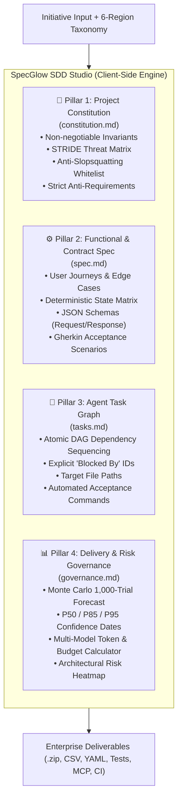
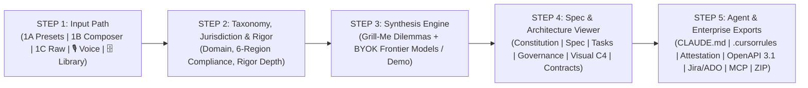

# 🚀 SpecGlow SDD Studio (v3.1 Enterprise Release)
### Enterprise Agentic Spec-Driven Development & Delivery Governance Engine

> **Created by Syed Imon Rizvi (Mercer and Mills) — Free & Open Source for Global IT Consultancies & Enterprise Teams.**  
> *100% Client-Side In-Memory Execution • Zero Backend Server Cost • Bring Your Own Key (BYOK) • Zero Telemetry*

---

[](LICENSE)
[](package.json)
[](https://react.dev)
[](https://www.typescriptlang.org)
[](https://tailwindcss.com)
[](https://vitejs.dev)
[](#-the-4-pillar-sdd-architecture)

---

## 📌 Executive Summary

Modern enterprise software engineering is fundamentally evolving from ad-hoc, hallucination-prone prompting to **Spec-Driven Development (SDD)**. Autonomous AI coding agents (Claude Code, Antigravity, Cursor, Devin) and multi-disciplinary distributed teams require deterministic architectural boundaries, zero-trust security invariants, and explicit dependency graphs to ship mission-critical software safely.

**SpecGlow SDD Studio** transforms feature briefs, requirements, and voice recordings into a comprehensive, machine-executable **Agent-Native SDD Delivery & Governance Suite** tailored to major global markets (US, EU, GCC, ANZ, APAC, and Pakistan).

---

## 🌟 What's New in v3.1 Enterprise Release

### 1. 🌐 Platform Target Runtime Architecture
Enforce platform-native UX invariants, viewport responsiveness, touch target thresholds, and caching boundaries tailored directly to your target deployment environment:
- **Web Portals & Apps:** Next.js 15 App Router, Server-Side Rendering (SSR), edge caching, and SEO optimization.
- **Mobile iOS & Android:** React Native (Expo SDK 52), offline SQLite persistence, 48px touch targets, and native push credentials.
- **Enterprise B2B SaaS:** Multi-tenant organization isolation, granular RBAC (Row-Level Security), and subscription billing rails.
- **High-Volume E-Commerce:** Sub-second catalog caching, distributed Redis inventory locking, and idempotent checkout webhooks.

### 2. ⚡ Preferred Tech Stack & UI System Selector (Strict Library Gating)
Eliminate agent hallucinated packages and mismatched styling conventions by locking exact library imports into `.cursorrules`, `CLAUDE.md`, and `AGENTS.md`:
- **Next.js 15 (App Router) + shadcn/ui:** Strict `@/components/ui` component imports with zero black-box dependencies.
- **Astro 5 + Content Collections:** Zero-JS client by default, MDX documentation, and perfect 100/100 Lighthouse performance.
- **React Native (Expo SDK 52):** NativeWind v4 (Tailwind), local SQLite offline persistence, and universal deep links.
- **Flutter 3.x + Material 3 (Dart):** Strict Riverpod state management and cross-platform native graphics compilation.
- **FastAPI (Python 3.12) + React 19 SPA:** Automated OpenAPI contracts paired with an ultra-responsive React SPA.
- **Stack-Agnostic / AI Standard:** Decoupled REST/GraphQL contracts allowing autonomous agents to select local toolchains.

### 3. 💡 Interactive Plain-English Architecture Helpers & Real-World Analogies
- Every Platform Target, Tech Stack preset, and multilingual toggle features a clickable **(?)** helper button.
- Designed for non-technical executives, product managers, and senior engineers alike, providing real-world analogies (e.g. *comparing Astro to a stripped-down racing bike or Next.js to an architect-designed home*), "Best Used For" criteria, and "When to Avoid" warnings.
- Includes a 1-click **"Select This Option"** action directly inside the modal.

### 4. 🎙️ In-Browser Voice Co-Pilot & Audio Dictation (Web Speech API)
- Speak your idea or feature request naturally using your microphone with zero server audio streaming.
- Built-in intent parser automatically transcribes your voice, detects the matching regulatory domain and delivery rigor, and drafts an initial engineering brief.

### 5. ✨ AI Idea Explorer & Architecture Advisor ("The Guiding Hand")
- Unsure how to structure an unrefined or raw concept? Click **"✨ AI Idea Advisor"** to get instant senior solutions architect advice.
- Evaluates your idea against legal compliance regimes, user accessibility requirements, and technical scalability, returning a polished vision brief and concrete recommendations for Platform Target, Tech Stack, and Team Topology with 1-click apply.

### 6. 🔄 Dynamic Dilemma Re-Generation (Live AI Interrogation)
- In Stage 3, click **"🔄 Re-Generate Dilemmas for My Project (AI)"** at any time.
- Queries live frontier AI (or intelligent heuristic engine) to formulate tailored architectural dilemmas specifically addressing your chosen platform target (e.g. mobile offline SQLite sync vs. REST, or high-volume Redis inventory locks vs. DB rows).

### 7. 🌍 Multilingual & Right-to-Left (RTL) Support (Arabic / Urdu / English)
- Enforces CSS logical properties (`ms-`, `me-`, `ps-`, `pe-`, `start-`, `end-`) instead of legacy physical coordinates (`ml-`, `mr-`, `pl-`, `pr-`, `left-`, `right-`).
- Mandates dynamic `dir="rtl"` layout switching, bidirectional typography mirroring, and Google Noto Naskh Arabic & Noto Nastaliq Urdu fallbacks in all AI agent prompt directives.

### 8. 🔑 Automated Production `.env.example` & Hosting Cloud Blueprints
- Automatically generated `.env.example` file included in Step 5 and the master `.zip` export bundle, dynamically tailored to your initiative's target platform and database providers.
- Comprehensive cloud production hosting blueprints documented in Pillar 4 (`governance.md`) for Vercel, Cloudflare R2, Supabase PostgreSQL, and Expo EAS.

### 9. 🛡️ 6-Region Regulatory & Compliance Matrix (16+ Frameworks)
Tailor every synthesized specification to jurisdictional mandates across 7 distinct profiles:
- **US / Canada (Federal & FinTech):** SOC 2 Type II, HIPAA, FedRAMP, CCPA, PCI-DSS v4.0, GLBA.
- **EU / UK (GDPR & Digital Sovereignty):** GDPR (Articles 25/32), DORA, EU AI Act, NIS2, UK Data Protection Act.
- **GCC / Middle East (Sovereignty & Privacy):** UAE PDPL, Saudi NDMO / SAMA Cyber Security Framework, UAE CBUAE standards.
- **Australia / New Zealand (CPS 234 & Privacy):** APRA CPS 234, Privacy Act 1988, Essential Eight, NZ Privacy Act 2020.
- **APAC / Singapore (MAS TRM & Cross-Border):** MAS Technology Risk Management Guidelines, Singapore PDPA, Cross-Border Privacy Rules.
- **Pakistan (SBP & Digital Governance):** State Bank of Pakistan (SBP) Framework for Enterprise Technology Governance, PECA 2016.
- **Global Enterprise Baseline:** ISO/IEC 27001:2022, SOC 2 Type II, and NIST Cybersecurity Framework 2.0.

### 7. 🎯 Proven Architectural Combinations Matrix

| Business Goal / Domain | Platform Target | Recommended Tech Stack | Compliance Profile | Production Cloud Blueprint |
| :--- | :--- | :--- | :--- | :--- |
| **High-Traffic E-Commerce Store** | High-Volume Commerce | Next.js 15 + shadcn/ui | PCI-DSS v4.0 & CCPA | Vercel + Upstash Redis + Stripe |
| **Consumer / Healthcare Mobile App** | Mobile iOS & Android | React Native (Expo 52) | HIPAA & HITECH | Expo EAS + SQLite + Supabase |
| **Enterprise B2B SaaS Platform** | Enterprise B2B SaaS | Next.js 15 + shadcn/ui | SOC-2 Type II & GDPR | Vercel + Neon Postgres (RLS) + Stripe |
| **EdTech LMS & Knowledge Hub** | Web Portals & Apps | Astro 5 or Next.js 15 | FERPA, COPPA, xAPI | Cloudflare Pages + Cloudflare R2 |
| **AI / ML Data Platform** | Enterprise B2B SaaS | FastAPI + React 19 SPA | ISO 27001 & SOC-2 | Fly.io / AWS ECS + Neon Postgres |
| **Global MENA / South Asia Bilingual** | Web Portals & Apps | Next.js 15 (RTL Enabled) | SAMA CSF & UAE PDPL | Vercel + Noto Fonts + Supabase |

---

## 🏛️ The 4-Pillar SDD Architecture



1. **📜 Project Constitution (`constitution.md`):** Non-negotiable technical constraints, runtime rules, security invariants, STRIDE threat mitigations, and explicit anti-requirements (strictly out-of-scope).
2. **⚙️ Functional & Contract Spec (`spec.md`):** Actor journeys, deterministic state transition matrices, API request/response JSON schemas, and executable Gherkin acceptance criteria.
3. **🤖 Agent-Executable Task Graph (`tasks.md`):** Atomic tasks sequenced in a directed acyclic graph (DAG) with explicit dependency blockers (`Blocked By`), target file paths, and automated acceptance test commands for AI coding agents.
4. **📊 Delivery & Risk Governance (`governance.md`):** Sprint velocity forecasting (Fibonacci story points), interactive 1,000-trial Monte Carlo delivery simulation with P50/P85/P95 percentile commitments, multi-model frontier AI token & budget calculator (Claude 3.5 Sonnet, GPT-4o, Gemini 1.5 Pro, DeepSeek V3/R1), architectural risk matrix, and a steering-committee-ready executive status report.

---

## 🗺️ End-to-End 5-Step Workflow



### **STEP 1: Requirement Ingestion, Brownfield Context & Library**
- **Path 1A (1-Click Enterprise Presets):** Instant real-world initiatives across FinTech, HealthTech, and Cloud SaaS.
- **Path 1B (Interactive PRD Composer):** Multi-archetype builder allowing engineers to combine topologies, capability engines, personas, and security invariants with custom architectural rationales.
- **Path 1C (Direct PRD Textarea):** Direct markdown, meeting transcripts, or user stories.
- **🎙️ Voice Co-Pilot (In-Browser Audio):** Speak your idea naturally using microphone dictation; the engine auto-transcribes, identifies the domain, and drafts the brief.
- **✨ AI Idea Explorer & Advisor:** Click to let senior AI analyze your unrefined idea and recommend the optimal domain, platform target, and tech stack in plain English.
- **📁 Brownfield Ingestion:** Paste existing schemas (`schema.prisma`, SQL DDL), `package.json`, or API routing files so the AI preserves and extends existing database tables and packages.
- **🗄️ Saved Initiatives Library:** Access previously generated initiatives stored in browser IndexedDB with 1-click restore.
- **🔄 Bidirectional Rehydration:** Click **"Import SDD Manifest"** to upload any previously exported `sdd-manifest.json` and restore all state into memory.

### **STEP 2: Industry Taxonomy, Regulatory Jurisdiction & Rigor**
- **Domain Categories:** FinTech & Banking, HealthTech & Life Sciences, GovTech & Public Sector, Cloud B2B SaaS, Omnichannel Commerce, AI & Data Engineering, and Custom Domains.
- **Platform Target Architecture:** Web Portals (Next.js/SSR), Mobile iOS & Android (Expo SDK 52), Enterprise B2B SaaS (Multi-Tenant RLS), or High-Volume E-Commerce.
- **Preferred Tech Stack & UI:** Next.js 15 App Router + shadcn/ui, Astro 5, React Native Expo, Flutter 3.x, FastAPI + React 19, or Stack-Agnostic.
- **6-Region Compliance Matrix:** Select from US/Canada, EU/UK, GCC/Middle East, ANZ, APAC, Pakistan, or Global Baseline.
- **Delivery Rigor:**
  - *MVP / Fast-Track:* Rapid velocity, core happy paths, essential security guards.
  - *Standard Agile Sprint:* Full edge cases, balanced contracts, regression test graph.
  - *Mission-Critical / Enterprise:* Maximum rigor, strict audit invariants, zero-trust constraints.

### **STEP 3: Architectural Interrogation ("Grill-Me" Loop) & Synthesis**
- **🛡️ Architectural Interrogation (Grill-Me Loop):** Challenges assumptions before generation with 3 to 5 critical architectural dilemmas, including mandatory jurisdiction-specific dilemmas (e.g., GCC data residency, EU GDPR Article 25 privacy by design, or US HIPAA audit logging).
- **🔄 Dynamic Project Dilemma Generator:** Click **"🔄 Re-Generate Dilemmas for My Project (AI)"** to have live AI analyze your exact requirements, platform target, and tech stack, formulating dilemmas specifically tailored to your technical architecture.
- **Injected Invariants:** Confirmed trade-offs and brownfield assets are directly injected into prompt context and locked inside `constitution.md`.
- **Flexible Modes:** Full interactive interrogation with custom trade-offs, 1-click standard defaults, or **Instant Offline Demo**.

### **STEP 4: Inspect 4-Pillars, Diagrams & Machine Contracts**
- **6-Tab Navigation:**
  - `constitution.md`: Security invariants, STRIDE threat matrix, anti-requirements, package whitelist.
  - `spec.md`: User journeys, state matrix, JSON contracts, Gherkin scenarios.
  - `tasks.md`: Sequenced atomic DAG tasks with blockers.
  - `governance.md`: Monte Carlo 1,000-trial delivery simulation, multi-model AI token budget estimator, and risk heatmap.
  - `📐 Visual Architecture`: Interactive C4 Context, Sequence, and ERD diagrams rendered live via client-side Mermaid.js with SVG download.
  - `🧪 Machine Contracts & Tests`: Standards-compliant OpenAPI 3.1 YAML schema, executable Vitest/Playwright acceptance test harness, and live MCP IDE bridge.

### **STEP 5: Agent, Contract & Enterprise Exports**
- **Client Security Attestation (`SECURITY-ATTESTATION.md`):** Executive compliance and security verification document.
- **Agent Instruction Contracts:** 1-click clipboard or download for `CLAUDE.md` (Claude Code CLI), `AGENTS.md` (Universal Agentic Standard), and `.cursorrules` (Cursor IDE / Windsurf).
- **Standalone Zero-Dependency MCP Server (`mcp-server.js`):** Executable Node 18+ JSON-RPC 2.0 stdio server connecting Cursor and Claude Code (`claude mcp add`) directly to the spec with zero `npm install` needed.
- **Continuous Spec Invariant Guardrail (`.github/workflows/sdd-verify.yml`):** Token-budgeted GitHub Actions workflow with pathspec exclusions and a safety budget gating pull requests against anti-requirements and forbidden dependencies.
- **Enterprise Project Management Sync:** 1-click `jira-tasks.csv` (RFC 4180 bulk import for Jira/Linear), `ado-work-items.csv` (Microsoft Azure DevOps Boards format), and `import-tasks.sh` (executable GitHub CLI script to batch-create issues with story points and labels).
- **1-Click Complete SDD Bundle:** Pure client-side PKZIP stream packaging all 18+ documentation, contract, test suite, agent instruction, CI guardrail, MCP config, and diagram files with zero external server dependencies.

---

## 🔒 100% Client-Side Privacy (BYOK Architecture)

SpecGlow SDD Studio runs with **zero proprietary backend servers**. 

- **Direct In-Browser Invocations:** Requirements and API keys never touch an intermediate proxy or server.
- **Zero Third-Party Telemetry:** Requirements, API keys, and generated specifications remain strictly in your browser.
- **Local Storage & IndexedDB Sandbox:** Provider configurations, saved initiatives, and themes persist exclusively in your device's browser memory.

### Supported Model Providers:
| Provider | Default Base URL | Recommended Models | Notes |
| :--- | :--- | :--- | :--- |
| **Google Gemini** | `https://generativelanguage.googleapis.com/v1beta` | `gemini-2.5-flash`, `gemini-4-argon` | Native structured JSON support |
| **Anthropic** | `https://api.anthropic.com/v1` | `claude-3-5-sonnet`, `claude-3-7-sonnet` | Direct browser access enabled |
| **OpenAI** | `https://api.openai.com/v1` | `gpt-4o-mini`, `gpt-4o`, `gpt-4.5` | Industry standard structured outputs |
| **Groq** | `https://api.groq.com/openai/v1` | `llama-3.3-70b-versatile` | Ultra-fast LPU inference |
| **DeepSeek** | `https://api.deepseek.com/v1` | `deepseek-chat`, `deepseek-reasoner` | High-reasoning coding models |
| **Local Ollama** | `http://localhost:11434/v1` | `llama3`, `mistral`, `deepseek-r1` | 100% offline & local (No key needed) |
| **xAI** | `https://api.x.ai/v1` | `grok-2-1212`, `grok-3` | High-throughput reasoning |
| **OpenRouter** | `https://openrouter.ai/api/v1` | Any OpenRouter endpoint | Universal multi-model gateway |
| **Custom Gateway** | Configurable | Any OpenAI-compatible proxy | Enterprise LiteLLM, vLLM |

---

## 📦 In-Browser ZIP Bundler Artifact Suite

Clicking **"Download Complete SDD Bundle (.zip)"** packages the complete 18+ artifact suite directly into a standard ZIP archive in client memory using binary Uint8Array streams:
```
sdd-bundle-[initiative-name].zip
├── constitution.md              # Project Constitution & STRIDE Threat Modeling Matrix
├── spec.md                      # Functional & Contract Specifications
├── tasks.md                     # Agent-Executable Task Graph (DAG)
├── governance.md                # Sprint Velocity & Risk Governance
├── SECURITY-ATTESTATION.md      # Client Security & Architecture Attestation Report
├── CLAUDE.md                    # Tailored instructions for Claude Code CLI
├── AGENTS.md                    # Universal AI Agent Operational Directive
├── .cursorrules                 # Cursor IDE / Windsurf Context Rules
├── openapi.yaml                 # OpenAPI 3.1 Contract Specification
├── tests/acceptance.spec.ts     # Vitest & Playwright Acceptance Harness
├── .github/workflows/sdd-verify.yml # Token-budgeted PR Invariant Guardrail
├── specglow-mcp.json            # Model Context Protocol configuration
├── mcp-server.js                # Standalone Node 18+ stdio MCP Server (0 deps)
├── jira-tasks.csv               # RFC 4180 CSV for Jira / Linear bulk import
├── ado-work-items.csv           # Azure DevOps Boards Work Item CSV
├── import-tasks.sh              # Executable GitHub CLI (gh) issue creator
├── architecture-c4.mermaid      # C4 System Context Diagram source
├── architecture-sequence.mermaid# End-to-End Sequence Diagram source
├── architecture-erd.mermaid     # Data Model & State Transition source
├── .env.example                 # Cloud, Database & Auth Environment Template
└── sdd-manifest.json            # Bi-directional rehydration manifest
```

---

## 🚀 Quickstart & Local Development

```bash
# Clone the repository
git clone https://github.com/your-username/specglow-sdd-studio.git
cd specglow-sdd-studio

# Install dependencies
npm install

# Start local development server
npm run dev

# Run compilation check & build
npm run build

# Run linter
npm run lint

# Preview production build locally
npm run preview
```

---

## 📜 License & Open-Source Attribution

This project is licensed under the **Apache-2.0 License** — see the [LICENSE](LICENSE) file for details.

**Created by:**  
**Syed Imon Rizvi (Mercer and Mills)**  
- 🌐 **Website:** [www.mercerandmills.com](https://www.mercerandmills.com)  
- 💼 **LinkedIn:** [https://www.linkedin.com/in/syedimonrizvi](https://www.linkedin.com/in/syedimonrizvi)  
- ✉️ **Contact:** [contact@mercerandmills.com](mailto:contact@mercerandmills.com)  

*Enterprise Solutions Architect & Agile Delivery Governance Leader*
